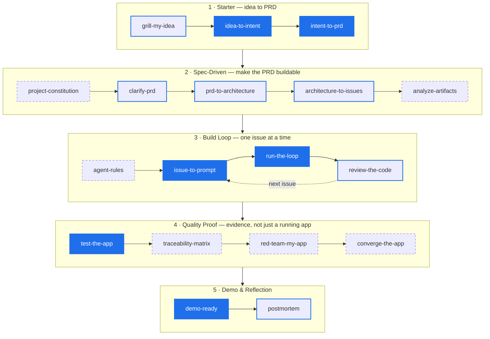
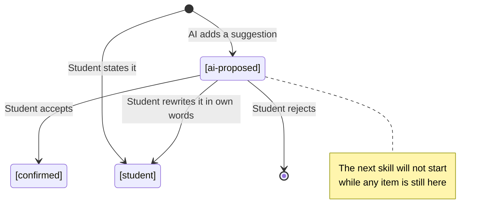
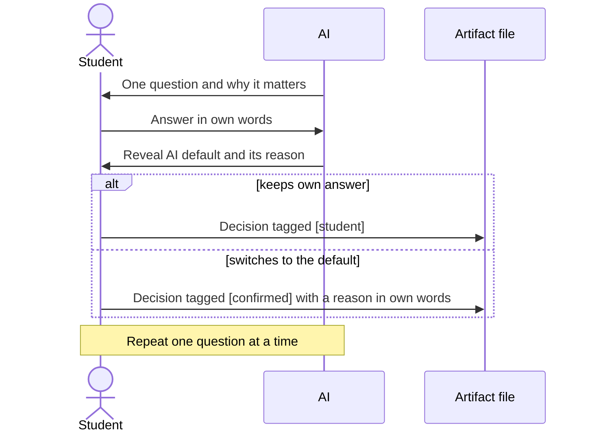

# AI-Native App Builder Skill Pack

A skill pack that guides students from a vague app idea to tested, explainable software built with AI, while the **decisions stay with the student**.

> **Core mantra:** Delegate tasks, not judgment.

AI drafts, compares, implements, and reviews. The student owns the intent, makes the decisions, verifies the result, and explains it.

```text
clear intent → structured artifacts → small AI-assisted loops → verified software → student explanation
```

**Who it is for:** students building apps with AI assistants, lecturers teaching AI-native software engineering, bootcamp mentors who want evidence rather than only code, and self-learners moving from vibe coding to disciplined building.

---

## Contents

1. [How It Works](#how-it-works)
2. [Choose Your Path](#choose-your-path)
3. [Quick Start](#quick-start)
4. [Skill Index](#skill-index)
5. [Student Judgment Guards](#student-judgment-guards)
6. [Artifact Rules](#artifact-rules)
7. [For Instructors](#for-instructors)
8. [Common Mistakes](#common-mistakes)
9. [Repository Layout](#repository-layout)
10. [Background](#background)

---

## How It Works

Each skill reads the previous artifacts from disk, produces one new artifact in `docs/ai-native/`, and stops for the student to review it before the next skill runs. The skills are grouped into five bundles that follow a project from idea to demo.



**Reading the diagram:** solid blue = Mini Path · blue outline = added in the Class Project Path · dashed = added in the Capstone Path. Every arrow is a stop where the student reads the saved artifact and decides whether to continue.

Each bundle page has the copy-paste prompts and the teacher checkpoint for its stage:

| Bundle | Use when | Main outputs |
|---|---|---|
| [01 · Starter](./bundles/01-starter/README.md) | You only have a raw idea | Grill report, Intent Brief, PRD |
| [02 · Spec-Driven](./bundles/02-spec-driven/README.md) | Before any coding | Constitution, clarification log, architecture, issues, artifact analysis |
| [03 · Build Loop](./bundles/03-build-loop/README.md) | During implementation | `AGENTS.md`, issue prompt, loop log, code review |
| [04 · Quality Proof](./bundles/04-quality-proof/README.md) | Before submission | Test plan, traceability matrix, risk review, convergence report |
| [05 · Demo & Reflection](./bundles/05-demo-reflection/README.md) | Before presenting | Demo script, postmortem |
| [06 · Advanced](./bundles/06-advanced/README.md) | Larger or capstone projects | Feature folders, checklists, GitHub issue workflows |

---

## Choose Your Path

You do not need all 18 skills for every project. Start small and add skills only when the project needs more evidence.

| Path | Best for | Skills | Adds |
|---|---|---:|---|
| **Mini** | 1-week assignment, prototype, first-time students | 6 | `idea-to-intent`, `intent-to-prd`, `issue-to-prompt`, `run-the-loop`, `test-the-app`, `demo-ready` |
| **Class Project** | A normal multi-week course project | 12 | Mini + `grill-my-idea`, `clarify-prd`, `prd-to-architecture`, `architecture-to-issues`, `review-the-code`, `postmortem` |
| **Capstone** | Final projects, research prototypes, serious portfolio work | 18 | Class + `project-constitution`, `analyze-artifacts`, `agent-rules`, `traceability-matrix`, `red-team-my-app`, `converge-the-app` |

**Mini Path minimum artifacts:** `02-intent-brief.md`, `03-prd.md`, `07-issue-prompt.md`, `08-loop-log.md`, `10-test-plan.md`, `12-demo-script.md`.

> **Recommendation:** start with the Mini Path. Move up when the project needs stronger traceability, a security/privacy review, or a clear ready / not-ready decision.

---

## Quick Start

### 1. Install the skills

With a tool that supports [`skills.sh`](https://skills.sh/):

```bash
# all skills, globally
npx -y skills add andrewtliem/ai-native-app-builder-skills --all -g

# Codex only
npx -y skills add andrewtliem/ai-native-app-builder-skills --agent codex --skill '*' -g -y

# current project only
npx -y skills add andrewtliem/ai-native-app-builder-skills --all

# preview what is available
npx -y skills add andrewtliem/ai-native-app-builder-skills --list
```

No `skills.sh`? See [Manual use](#manual-use-without-skillssh).

### 2. Open your project folder

```bash
mkdir my-ai-native-app && cd my-ai-native-app
```

Every skill saves its artifact under `docs/ai-native/`.

### 3. Run the first skill

```text
Use the grill-my-idea skill in classroom mode.

My app idea is:
[write your idea here]

Interview me one question at a time and wait for my answer. Do not suggest answers.
Save my answers verbatim to docs/ai-native/01-grill-my-idea.md.
```

Then follow the prompts in [Bundle 01 · Starter](./bundles/01-starter/README.md). **Run one skill per prompt**, read the saved file, and only then continue.

---

## Skill Index

| # | Skill | Purpose | Artifact | Bundle |
|---:|---|---|---|---|
| 01 | [`grill-my-idea`](./skills/grill-my-idea/SKILL.md) | Interview the student to pressure-test a raw idea | `01-grill-my-idea.md` | 01 |
| 02 | [`idea-to-intent`](./skills/idea-to-intent/SKILL.md) | Capture purpose, users, constraints, success criteria | `02-intent-brief.md` | 01 |
| 03 | [`intent-to-prd`](./skills/intent-to-prd/SKILL.md) | Write a PRD with `US`, `FR`, `SC` IDs | `03-prd.md` | 01 |
| 04 | [`project-constitution`](./skills/project-constitution/SKILL.md) | Define non-negotiable principles and quality gates | `14-project-constitution.md` | 02 |
| 05 | [`clarify-prd`](./skills/clarify-prd/SKILL.md) | Resolve up to five high-impact ambiguities | `15-clarification-log.md` | 02 |
| 06 | [`prd-to-architecture`](./skills/prd-to-architecture/SKILL.md) | Design the system, with read-back diagrams | `04-architecture.md` | 02 |
| 07 | [`architecture-to-issues`](./skills/architecture-to-issues/SKILL.md) | Break work into small `T###` issues | `05-issues.md` | 02 |
| 08 | [`analyze-artifacts`](./skills/analyze-artifacts/SKILL.md) | Find contradictions and gaps before coding | `16-artifact-analysis.md` | 02 |
| 09 | [`agent-rules`](./skills/agent-rules/SKILL.md) | Write project rules for AI assistants | `AGENTS.md` | 03 |
| 10 | [`issue-to-prompt`](./skills/issue-to-prompt/SKILL.md) | Turn one issue into one focused prompt | `07-issue-prompt.md` | 03 |
| 11 | [`run-the-loop`](./skills/run-the-loop/SKILL.md) | Build, test, fix, and decide for one issue | `08-loop-log.md` | 03 |
| 12 | [`review-the-code`](./skills/review-the-code/SKILL.md) | Explanation check, then review against requirement IDs | `09-code-review.md` | 03 |
| 13 | [`test-the-app`](./skills/test-the-app/SKILL.md) | Tests that each name the IDs they verify | `10-test-plan.md` | 04 |
| 14 | [`traceability-matrix`](./skills/traceability-matrix/SKILL.md) | Map every requirement to proof | `17-traceability-matrix.md` | 04 |
| 15 | [`red-team-my-app`](./skills/red-team-my-app/SKILL.md) | Find misuse, privacy, security, and UX risks | `11-risk-review.md` | 04 |
| 16 | [`converge-the-app`](./skills/converge-the-app/SKILL.md) | Compare the app against its intended artifacts | `18-convergence-report.md` | 04 |
| 17 | [`demo-ready`](./skills/demo-ready/SKILL.md) | Prepare an honest demo script | `12-demo-script.md` | 05 |
| 18 | [`postmortem`](./skills/postmortem/SKILL.md) | Reflect on what AI helped, misled, and what was verified | `13-postmortem.md` | 05 |

> **Artifact numbers are stable IDs, not run order.** For example, `14-project-constitution.md` and `15-clarification-log.md` are created before `04-architecture.md`. Follow the bundle order for sequence.

---

## Student Judgment Guards

A pipeline like this makes it easy for AI to draft every artifact, including the decisions inside it. These guards keep those decisions visibly the student's.

### 1. Decision provenance

Every line that states a user, problem, scope, requirement, success criterion, or architecture decision carries a tag that says who decided it:

| Tag | Meaning |
|---|---|
| `[student]` | The student said it in their own words. |
| `[ai-proposed]` | AI suggested it; the student has not accepted it yet. |
| `[confirmed]` | AI suggested it; the student explicitly accepted it. |



`idea-to-intent`, `intent-to-prd`, `project-constitution`, and `prd-to-architecture` run a **Decision Provenance Gate**. They stop if an upstream artifact still has `[ai-proposed]` items, and each reports `Open ai-proposed items` when it finishes.

### 2. Classroom mode (default)

The student commits to an answer before seeing what AI would choose.



| Skill | Classroom mode behavior |
|---|---|
| `grill-my-idea` | An interview, not a questionnaire. No suggested answers. Student answers saved verbatim. |
| `clarify-prd` | Student answers first; the AI default comes after. The log keeps first answer, default, final decision, reason for change, and a default-match count. |
| `review-the-code` | Before the AI review, the student explains one block and predicts one edge case. A loop cannot be accepted while the check is `Not yet`. |

Practitioner mode is available when the instructor or user explicitly asks for it.

### 3. Read-back diagrams

`prd-to-architecture` adds Mermaid diagrams only where prose is easy to misread: entity lifecycles, flows with several parties, and related entities. Any behavior a diagram shows that the PRD does not state becomes a **read-back assumption** for the student to confirm or reject. A rejection means the PRD must be fixed before coding.

See the [simple todo app example](./examples/simple-todo-app/README.md) for the full chain: the student rejects three AI suggestions with reasons, and a wrong edge-case prediction exposes a real validation bug.

---

## Artifact Rules

> If it is not saved to a project file, it is not part of the project memory.

Every skill follows the same protocol:

1. Check that the upstream artifact files exist in `docs/ai-native/`.
2. Read them from disk, not from chat history.
3. If one is missing, stop and ask the student to run the earlier skill.
4. Write the new artifact with a `Sources Read` section listing the files actually read.
5. End with `Saved artifact:` and `Next recommended skill:`, then wait for the student.

This is what lets an instructor grade the **process**, not only the final app: chat disappears, files remain.

---

## For Instructors

### A 5-week flow

| Week | Student activity | Bundle |
|---:|---|---|
| 1 | Frame the idea | [01 · Starter](./bundles/01-starter/README.md) |
| 2 | Specify and design | [02 · Spec-Driven](./bundles/02-spec-driven/README.md) |
| 3 | Build issue by issue | [03 · Build Loop](./bundles/03-build-loop/README.md) |
| 4 | Prove it works | [04 · Quality Proof](./bundles/04-quality-proof/README.md) |
| 5 | Demo and reflect | [05 · Demo & Reflection](./bundles/05-demo-reflection/README.md) |

Each bundle page ends with a **teacher checkpoint**: what the student should be able to show before moving on.

### Suggested grading categories

| Category | Evidence |
|---|---|
| Student judgment | Grill transcript, provenance tags, reasons in the clarification log |
| Intent clarity | Intent Brief and PRD |
| Design quality | Architecture and issues |
| AI process discipline | Issue prompt, loop log, code review with explanation check |
| Verification | Test plan and traceability matrix |
| Responsibility | Risk review, convergence report, postmortem |

### Quick signals worth checking

- **Grill transcript:** are the answers the student's words, or polished AI prose?
- **`[student]` vs `[confirmed]`:** a project made almost entirely of `[confirmed]` decisions deserves a conversation.
- **Default-match count** in the clarification log: matching every AI default is not wrong, but the student should be able to defend each choice.
- **Explanation check rating** in each code review.

---

## Common Mistakes

| Mistake | Instead |
|---|---|
| Running every skill in one prompt | One skill per prompt. Read the artifact. Decide. |
| Letting AI invent the app | AI may suggest; the student owns the intent. |
| Rubber-stamping AI defaults | Answer first, then compare. Record a reason whenever you switch. |
| Letting answers live only in chat | Save grill and clarification answers verbatim in the artifact. |
| Ignoring saved files | Always read `docs/ai-native/` before continuing. |
| Accepting AI code without review | Explain the code before the review; the loop is not accepted otherwise. |
| Treating a working demo as proof | Show requirement coverage in the traceability matrix. |

---

## Repository Layout

```text
skills/      installable skills (one SKILL.md each)
bundles/     learning paths: which skills to use together, prompts, teacher checkpoints
templates/   blank worksheets for PRD, architecture, issues, traceability, and more
examples/    a complete student-project artifact chain (simple todo app)
```

### Templates

Use these by hand if your AI tool does not support skills: [PRD](./templates/prd-template.md) · [Constitution](./templates/constitution-template.md) · [Architecture](./templates/architecture-template.md) · [Issue](./templates/issue-template.md) · [Artifact analysis](./templates/artifact-analysis-template.md) · [Traceability matrix](./templates/traceability-matrix-template.md) · [Convergence report](./templates/convergence-report-template.md) · [Checklist](./templates/checklist-template.md)

### Manual use without skills.sh

```bash
git clone https://github.com/andrewtliem/ai-native-app-builder-skills.git
```

Then point your assistant at the skill file:

```text
Use the instructions from skills/intent-to-prd/SKILL.md.
Read docs/ai-native/02-intent-brief.md first.
Save the PRD to docs/ai-native/03-prd.md.
```

---

## Background

### Ideas adapted from GitHub Spec Kit

| Spec Kit idea | Adaptation for students |
|---|---|
| Constitution | `project-constitution` defines non-negotiable rules and quality gates. |
| Clarification | `clarify-prd` asks up to five questions before architecture, answer-first. |
| Requirement IDs | PRDs use `US-###`, `FR-###`, and `SC-###`. |
| Artifact analysis | `analyze-artifacts` checks PRD, architecture, and issues before coding. |
| Traceability | `traceability-matrix` maps requirements to issues, tests, and evidence. |
| Convergence | `converge-the-app` compares the built app against the intended artifacts. |

The goal is not to copy Spec Kit exactly, but to make spec-driven thinking practical for students.

### Teaching philosophy

This pack is shaped by two talks on AI-native software engineering, read through ATL's own teaching perspective (other educators may draw different lessons):

- https://www.youtube.com/watch?v=q_Jq4IgYImk
- https://www.youtube.com/watch?v=VTYx7Ex-0bA

> AI-native engineering is not about generating more code faster. It is about clearer intent, better systems, stronger verification, and human judgment.
