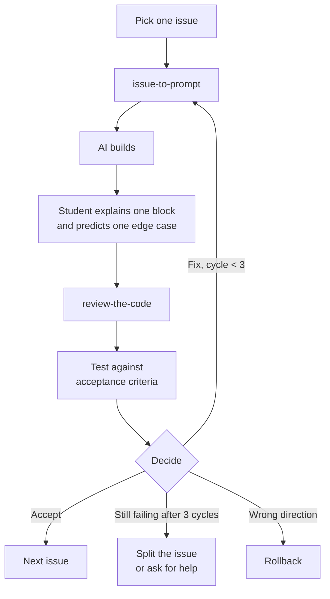

# Build Loop Bundle

**Purpose:** Use AI to implement one small issue at a time without surrendering judgment.

**When to use:** Use repeatedly during implementation, one issue at a time.

## Skills

| Skill | Role |
|---|---|
| [`agent-rules`](../../skills/agent-rules/SKILL.md) | Create AGENTS.md or project rules for AI assistants. |
| [`issue-to-prompt`](../../skills/issue-to-prompt/SKILL.md) | Turn one issue into a focused AI coding prompt. |
| [`run-the-loop`](../../skills/run-the-loop/SKILL.md) | Run one build/review/test/fix loop. |
| [`review-the-code`](../../skills/review-the-code/SKILL.md) | Review generated code against intent, architecture, safety, and explainability. |

## The Loop

Run one issue at a time. Stop after three cycles and diagnose instead of prompting harder.



## Outputs

```text
AGENTS.md
docs/ai-native/07-issue-prompt.md
docs/ai-native/08-loop-log.md
docs/ai-native/09-code-review.md
```

## Student prompts

```text
Use agent-rules.
Read the PRD, architecture, and issues first.
Create AGENTS.md so AI assistants follow this project’s intent, stack, style, and verification rules.
```

```text
Use issue-to-prompt.
Read docs/ai-native/05-issues.md and select Issue [number].
Create one focused coding prompt for that issue only.
Save the output to docs/ai-native/07-issue-prompt.md.
```

```text
Use run-the-loop.
Run one safe AI-assisted build loop for this issue.
Record build steps, review notes, test results, fixes, and the final decision.
Save the log to docs/ai-native/08-loop-log.md.
```

```text
Use review-the-code.
Read the issue, PRD, architecture, and loop log.
Before reviewing, ask me to explain one block and predict one edge case in my own words.
Then review the implementation against the requirement IDs and flag must-fix items.
Save the review to docs/ai-native/09-code-review.md.
```

## Teacher checkpoint

The student should show:

- The issue they worked on.
- The prompt they gave AI.
- The code diff or changed files.
- Review findings.
- Test or manual evidence.
- A decision: accept, fix, rollback, split, or ask for help.

## Teaching Note

Students should run these skills one at a time, read the saved artifact, make a human decision, revise if needed, then continue. The bundle is a teaching path, not an autopilot.

---

← [02-spec-driven](../02-spec-driven/README.md) · [Main README](../../README.md) · [04-quality-proof](../04-quality-proof/README.md) →
