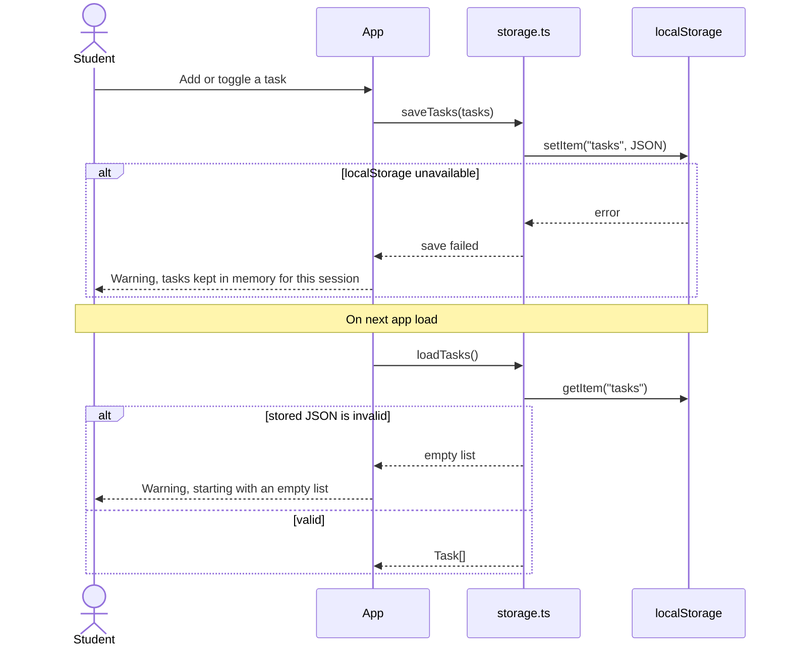

# Architecture Plan — Course Todo

## Sources Read
- docs/ai-native/03-prd.md
- docs/ai-native/14-project-constitution.md
- docs/ai-native/15-clarification-log.md

## Requirement Mapping

| Requirement / Story | Architecture Support | Notes |
|---|---|---|
| US-001, FR-001, FR-002 | Task form component + validation | Title and course required. |
| US-002, FR-004 | Task list item component | Toggle complete/incomplete. |
| US-003, FR-005, FR-006 | Filter controls + derived visible list | Course and status filters. |
| US-004, FR-007 | Local storage adapter | Save/load task array. |
| SC-004 | Refresh persistence check | Manual test in browser. |

## Stack Choice
- Frontend: Vite + React + TypeScript. `[confirmed]` (student: “React is what we use in the web course.”)
- Styling: plain CSS. `[confirmed]`
- Storage: `localStorage`. `[student]`
- Backend: none. `[student]`
- Auth: none. `[student]`

## System Parts
- `App`: owns task state and filter state.
- `TaskForm`: creates tasks and validates inputs.
- `TaskList`: renders filtered tasks.
- `TaskItem`: toggles completion.
- `TaskFilters`: controls course/status filters.
- `storage.ts`: handles local storage read/write.

## Data Flow
1. User enters task title, course, and optional due date.
2. `TaskForm` validates input.
3. `App` adds task to state.
4. State is saved to `localStorage`.
5. `TaskFilters` updates visible task list.
6. On app load, tasks are restored from `localStorage`.

## Data Model

| Entity | Fields | Relationships | Validation |
|---|---|---|---|
| Task | id, title, course, dueDate?, completed, createdAt | none | title and course required |

## Diagrams

Only one flow is easy to misread in prose: saving and loading when storage can fail. The Task entity has just two states (open, done), so it gets no state diagram.

### Sequence: save and load (reader: student and reviewer; checks: storage failure paths match FR-007 and the clarification log)

## Read-Back Assumptions

Behavior shown in the diagram or data model that the PRD does not state.

| # | Assumption | Where It Appears | Student Decision | PRD / Clarification Update | Tag |
|---|---|---|---|---|---|
| A1 | Tasks are saved after every add or toggle, not with a Save button | Sequence: save and load | Confirm — “A Save button is one more thing to forget.” | Added to FR-007 wording | `[confirmed]` |
| A2 | Invalid stored JSON starts an empty list with a warning | Sequence: save and load | Confirm — “It's a class demo, losing broken data is acceptable for v1. I'll mention it as a limitation.” | Listed as a known limitation | `[confirmed]` |
| A3 | `createdAt` is stored on every task | Data model | Confirm — “Needed to keep the list in order.” | None; implementation detail | `[confirmed]` |

## Contracts

| Contract | Input | Output | Error States | Requirements |
|---|---|---|---|---|
| createTask | title, course, dueDate? | Task | empty title/course | FR-001, FR-002 |
| toggleTask | task id | updated Task | id not found | FR-004 |
| saveTasks | Task[] | void | localStorage unavailable | FR-007 |
| loadTasks | none | Task[] | invalid JSON | FR-007 |

## Research Notes

| Decision | Option Chosen | Alternatives | Rationale |
|---|---|---|---|
| Storage | localStorage | backend database, IndexedDB | simplest for v1 and privacy. |
| Framework | React | vanilla JS | common class stack and component practice. |
| Due date | optional string date | required date | lower friction for quick task capture. |

## Key Screens
- Main task dashboard.
- Task creation form.
- Filter controls.

## Security and Privacy Notes
- No network request is needed.
- Tasks remain in the browser.
- Do not add analytics or external scripts.

## Failure Cases
- Empty title/course: show validation message.
- Local storage unavailable: show warning and keep tasks in memory.
- Invalid stored JSON: reset to empty list with warning.

Saved artifact: docs/ai-native/04-architecture.md
Open ai-proposed items: 0
Next recommended skill: architecture-to-issues
