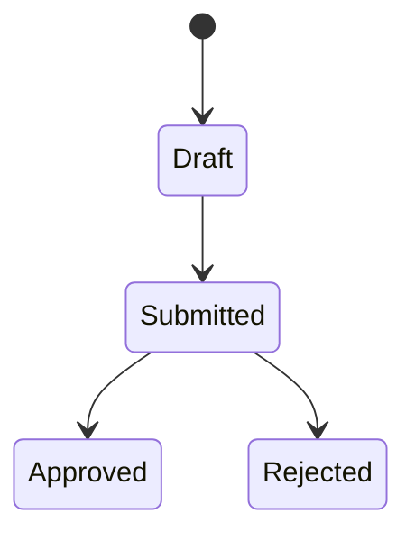

# PRD to Architecture

**Stage:** Phase 2 — Design the System

## Purpose

Use this skill to convert a PRD into a simple architecture plan before coding, so students understand system parts, data flow, risks, and technical choices.

## Shared Principles

These skills are based on two YouTube talks about AI-native software engineering, interpreted through ATL’s own teaching perspective.

- **Shift left on intent:** clarify goals, users, constraints, tradeoffs, and success before coding.
- **Delegate tasks, not judgment:** AI may draft, compare, or implement; the student remains responsible for decisions.
- **Verification is the bottleneck:** every output must include checks, acceptance criteria, or evidence.
- **No vibe coding:** do not jump from idea directly to generated code without intent, design, and review.
- **Small loops beat big guesses:** move one step at a time, verify, then continue.
- **AI amplifies the system:** unclear intent creates faster confusion; clear intent creates faster learning.
- **Mark who decided:** every decision in an artifact is tagged `[student]`, `[ai-proposed]`, or `[confirmed]` so the student's judgment stays visible.

## When to Use

- Use after `intent-to-prd`.
- Use before issue breakdown.
- Use for web, mobile, desktop, or API-based class projects.
- Do not over-engineer; choose the simplest architecture that satisfies the PRD.

## Inputs

- PRD.
- Preferred stack, if any.
- Deployment target, if known.
- Student/team skill level.

## Process

1. Summarize the app type and technical needs.
2. Choose the simplest viable stack.
3. Identify frontend, backend, database/storage, auth, external APIs, and deployment.
4. Describe the data flow in text.
5. Define key data models/entities.
6. Add Mermaid diagrams **only where structure is easy to misread** in prose:
   - a `stateDiagram-v2` for each entity that has a lifecycle (a status field such as draft → submitted → approved),
   - a `sequenceDiagram` for each flow that involves more than two parties or any external service, including its failure path,
   - an `erDiagram` when three or more entities are related.
   For each diagram, state who reads it and what it helps check. Skip diagrams nobody will use.
7. Identify security/privacy concerns.
8. Identify failure points and what should happen.
9. List architecture decisions and reasons.
10. **Read-back check.** List every place where a diagram or the data model shows behavior the PRD does not state — an extra transition, a call, an error path, a cardinality, a default value. Each one is an `[ai-proposed]` assumption. Ask the student to confirm or reject each. A rejected assumption means the PRD is ambiguous at that point: record the fix in the PRD or the clarification log before continuing.

## Decision Provenance Gate

This gate keeps the student's judgment visible as artifacts are chained. Tags: `[student]` = said by the student, `[ai-proposed]` = suggested by AI and not yet accepted, `[confirmed]` = suggested by AI and explicitly accepted by the student.

**Before drafting**

1. Scan the upstream artifacts (`docs/ai-native/03-prd.md`, `docs/ai-native/14-project-constitution.md`, `docs/ai-native/15-clarification-log.md`) for `[ai-proposed]` items. If any remain, stop, list them, and ask the student to confirm, reject, or replace each one. Update the upstream artifact before continuing.
2. If an upstream artifact has no provenance tags at all (made before this rule existed), ask the student to confirm its key decisions — user, problem, scope, success criteria — before relying on it.

**While drafting**

3. Carry tags forward: content derived from a `[student]` or `[confirmed]` item keeps that tag.
4. Tag anything new the AI adds as `[ai-proposed]`. Typical examples: the stack choice, storage choice, data model entities, and any architecture decision. Technology choices are allowed to start as AI proposals, but the student must confirm them and be able to state the reason.

**Before saving as final**

5. Walk through each `[ai-proposed]` item with the student, one at a time. Accepted items become `[confirmed]`; rejected items are removed or rewritten in the student's words as `[student]`.
6. Report the number of open `[ai-proposed]` items in the final response. The next skill will not start while it is above zero.

## Artifact Discipline

This skill must not only answer in chat. It must produce or update a project file so the next skill has a stable source of truth.

- **Write/update this file:** `docs/ai-native/04-architecture.md`
- **Artifact title:** Architecture Plan
- **Read these previous artifacts first:**
- `docs/ai-native/03-prd.md`
- If the project does not have `docs/ai-native/`, create it.
- If the target file already exists, update it carefully instead of creating a duplicate.
- Do not draft from memory: follow the Source Loading Protocol below before writing this file.
- End the response with a short `Saved artifact:` line naming the file path.
- Do not continue to the next skill until the user or student confirms this artifact is acceptable.

## Source Loading Protocol

Before producing this skill's output, the agent must explicitly load the upstream artifact files from the current project. Do not rely on pasted chat history if the files exist.

1. Check whether each required upstream file exists:
   - `docs/ai-native/03-prd.md`
2. Read every existing required file before drafting this artifact.
3. If a required upstream file is missing, stop and ask the student to run the previous skill or provide the missing file. Do not silently recreate or guess the missing source of truth.
4. In the saved artifact, include a short `Sources Read` section listing the files actually read.
5. If the student pasted newer content than the saved file, ask whether to update the upstream artifact first before continuing.

## Output Format

Every stack choice, data model entity, and architecture decision ends with a provenance tag, for example `| Storage | localStorage | ... | [confirmed] |`.

````markdown
# Architecture Plan

## Sources Read
- ...

## Requirement Mapping
| Requirement / Story | Architecture Support | Notes |
|---|---|---|
| FR-001 / US-001 | ... | ... |

## Stack Choice
...

## System Parts
- Frontend: ...
- Backend: ...
- Database/Storage: ...
- Auth: ...
- External Services: ...

## Data Flow
1. ...

## Data Model
| Entity | Fields | Relationships | Validation |
|---|---|---|---|
| ... | ... | ... | ... |

## Diagrams
Only where structure is easy to misread. Each diagram names its reader and what it checks.

### State: <Entity> (reader: student and instructor; checks: allowed status changes)


## Read-Back Assumptions
Behavior shown in the diagrams or data model that the PRD does not state.

| # | Assumption | Where It Appears | Student Decision | PRD / Clarification Update | Tag |
|---|---|---|---|---|---|
| A1 | ... | State: Task | Confirm / Reject | ... | `[confirmed]` / `[student]` |

## Contracts
| Contract | Input | Output | Error States | Requirements |
|---|---|---|---|---|
| ... | ... | ... | ... | FR-001 |

## Research Notes
| Decision | Option Chosen | Alternatives | Rationale |
|---|---|---|---|
| ... | ... | ... | ... |

## Key Routes / Screens
- ...

## Security and Privacy Notes
- ...

## Failure Cases
- ...

## Architecture Decisions
- Decision: ... because ...
````

## Final Response Contract

When this skill finishes, respond briefly and include:

```text
Saved artifact: docs/ai-native/04-architecture.md
Open ai-proposed items: <number, should be 0>
Next recommended skill: <next-skill-or-human-review>
```

If you cannot write the file, say exactly why and do not pretend the artifact was saved.

## Quality Checklist

- [ ] Diagrams exist only where structure is easy to misread, and each names its reader and purpose.
- [ ] Every read-back assumption was confirmed or rejected by the student, and rejections were fed back to the PRD or clarification log.
- [ ] Every decision line carries a provenance tag and no `[ai-proposed]` items remain.
- [ ] Architecture is simpler than the maximum possible solution.
- [ ] Every system part has a reason.
- [ ] Architecture maps back to `US-###`, `FR-###`, or `SC-###` IDs.
- [ ] Data model and contracts are explicit where relevant.
- [ ] Technical decisions include rationale and alternatives considered.
- [ ] Data flow is understandable.
- [ ] Security/privacy risks are named.
- [ ] Student can explain the architecture verbally.

## Common Pitfalls

1. **Choosing trendy tools without reason.** Stack must fit student ability and PRD.
2. **Ignoring data ownership/privacy.** Student apps often collect personal data.
3. **Skipping failure cases.** Apps need behavior when things go wrong.

## Student Prompt Template

```text
Use `prd-to-architecture`.
Here is my PRD: [paste].
Create the simplest viable architecture plan, including system parts, data flow, data model, routes/screens, security/privacy notes, failure cases, and architecture decisions.

Save or update the artifact at `docs/ai-native/04-architecture.md`. End with `Saved artifact: docs/ai-native/04-architecture.md` and the next recommended skill.

Before drafting, read the required upstream artifact files listed in the skill. If any are missing, stop and report which file is missing.
```
